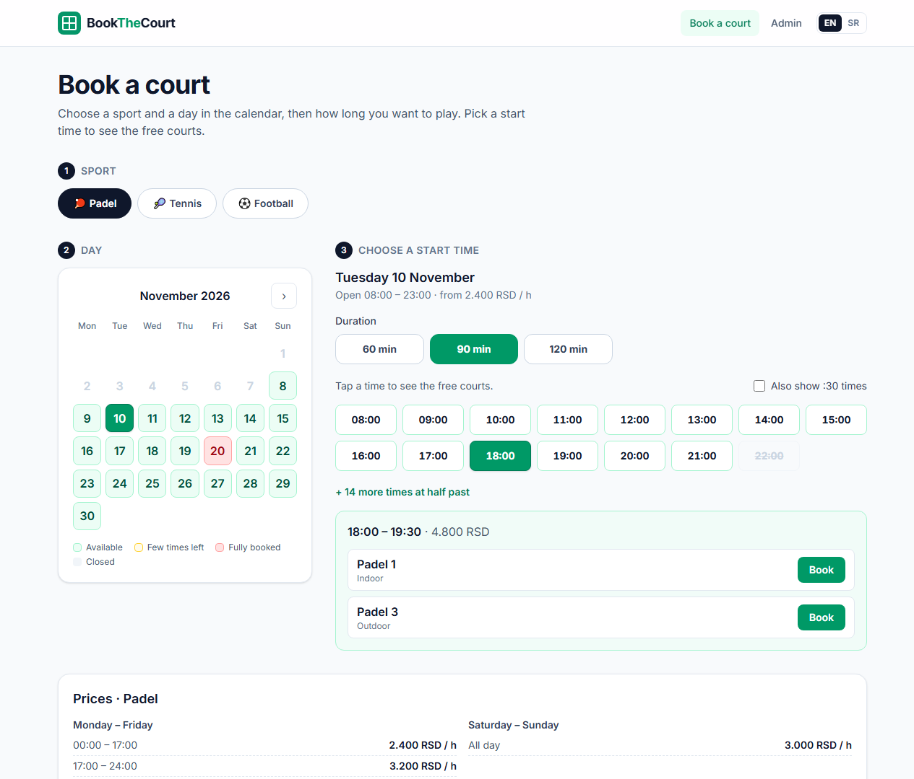
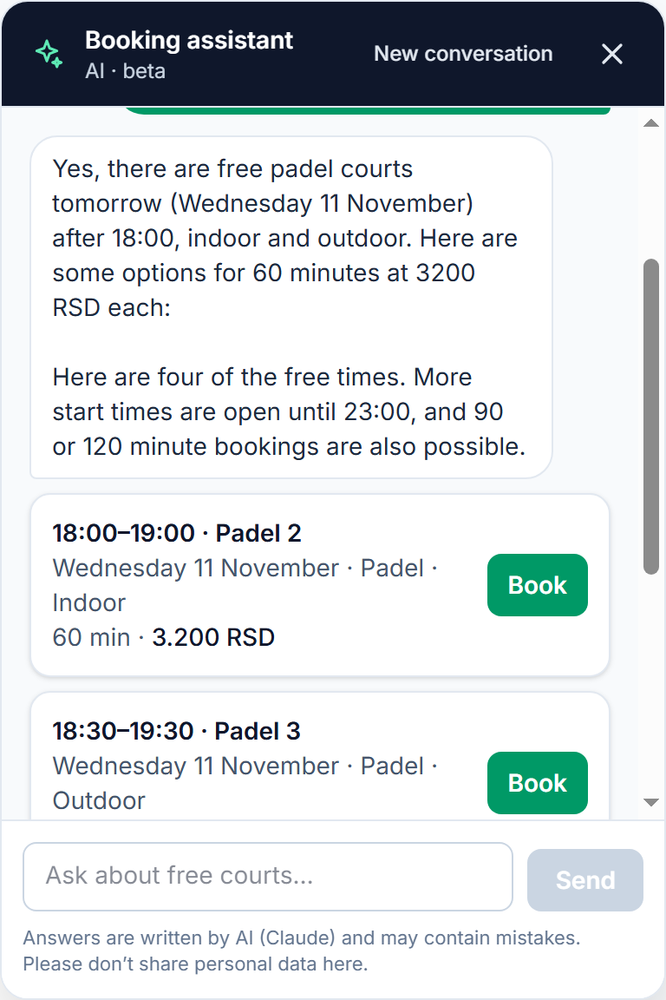
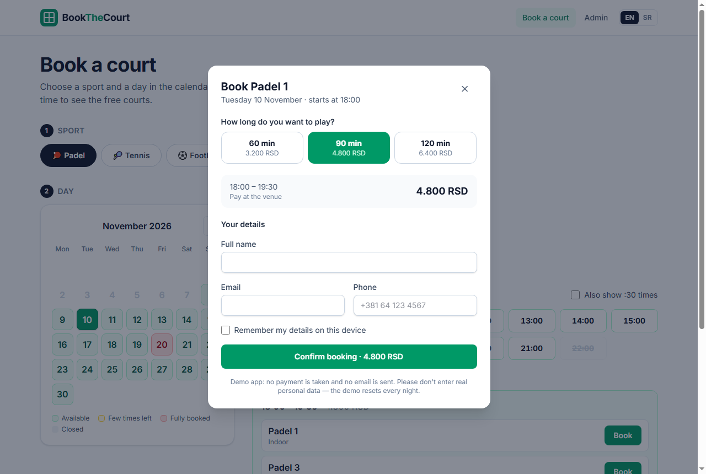
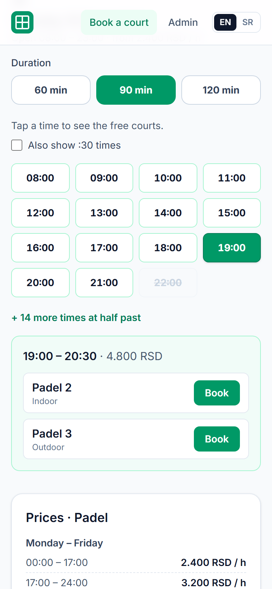
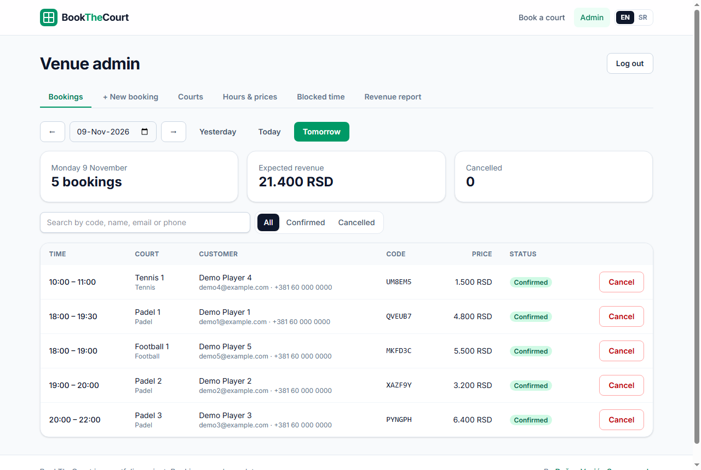
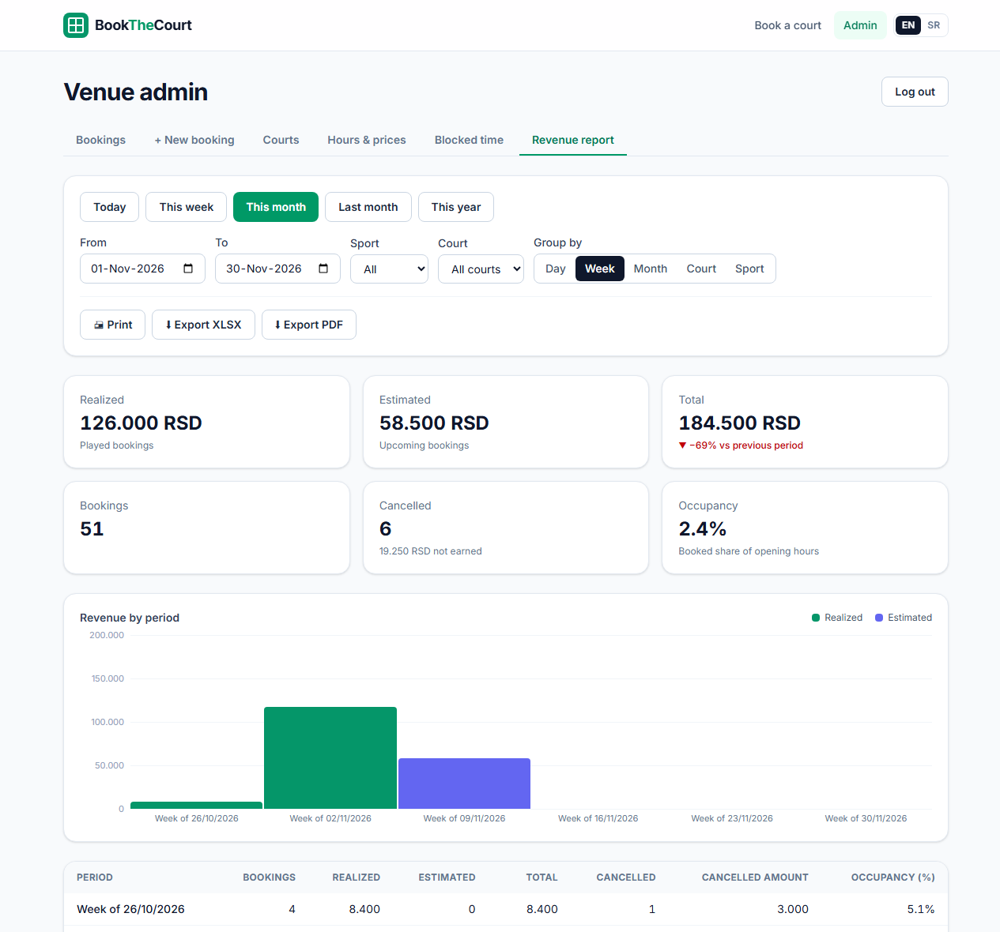

# BookTheCourt

[](https://github.com/dusanv-labs/book-the-court/actions/workflows/ci.yml)

A full-stack sports court booking system (padel, tennis, football): players pick a day in a calendar and book a free court in a few taps, or ask an **AI booking assistant** in plain language, and the venue owner manages courts, opening hours, prices, bookings and revenue from an admin panel. English and Serbian.

**[Live demo](https://dusanv-labs.github.io/book-the-court/)** · **[API docs (Swagger)](https://book-the-court-api.onrender.com/api/docs)** · Admin login: `demo@example.com` / `court-demo-2026`

> The demo database is reset every night, so feel free to book, cancel and change anything. The API runs on a free plan that sleeps when idle, so the first request can take up to a minute.



| AI booking assistant | |
|---|---|
|  | Ask in English or Serbian, e.g. *"Is there a free padel court tomorrow after 18:00?"*. The assistant looks up free courts and prices with tools that use the same API logic, and shows checked options as cards; **Book** opens the normal booking form. |

| Booking dialog | Mobile |
|---|---|
|  |  |

| Admin: bookings | Admin: revenue report |
|---|---|
|  |  |

## Features

**Players**
- Simple steps: sport → day in a month calendar (fully booked days in red) → duration → start time → court
- Start times as a grid of full hours (half hours on request); unavailable times are crossed out, and picking a time shows the free courts with the price
- Choose 60, 90 or 120 minutes with the price of each option shown upfront
- **Pay online by card** (Stripe Checkout, test mode) or at the venue; cancelling a paid booking refunds the card automatically
- Booking code, private manage/cancel link and **Add to calendar** (.ics)
- Optional "remember my details" for faster repeat bookings
- English and Serbian, detected from the browser and switchable at any time
- **AI booking assistant** (Claude): ask about free courts, prices, hours or rules in plain language and get bookable suggestions

**Venue owner (admin)**
- Daily bookings with quick day switching, search (code, name, email, phone) and status filter
- New bookings for phone or walk-in customers, using the same booking flow
- Courts: rename, change sport or type, activate/deactivate
- Opening hours (with "copy Monday to all weekdays") and price rules with warnings for gaps and overlaps
- Block time on one or all courts, with a list of all upcoming blocks
- **Revenue report**: realized (played) vs estimated (upcoming) revenue, cancellations and court occupancy; filter by period (with quick presets), sport and court; group by day, week, month, court or sport; comparison with the previous period; chart + table with totals; print, **XLSX** (with SUM formulas) and **PDF** export

**Engineering highlights**
- Double booking prevented at the database level (PostgreSQL exclusion constraint), verified by a test that fires 8 simultaneous requests for the same slot
- Online payments with Stripe Checkout: the court is held while the player pays, signed webhooks confirm the payment, and every payment step is safe to repeat (see below)
- Time zone and daylight saving time handled correctly: stored in UTC, opening hours and prices defined in local time
- Business logic (availability, pricing, revenue report) as pure functions covered by unit tests; API end-to-end tests against a real PostgreSQL database in CI
- Browser tests (Playwright, desktop and phone) click through booking, cancellation, admin login, the revenue report and the assistant, against the whole app started with Docker Compose in CI
- One-command local setup with Docker Compose (PostgreSQL, API with demo data, web app)
- JWT admin authentication, scrypt password hashing, rate limiting, security headers, Zod validation, OpenAPI docs
- Admin pages and export libraries are lazy-loaded, so players download only what they need
- AI assistant built as a tool-use agent (see below): read-only tools, suggestions re-checked by the booking rules, no customer data exposed to the model, daily budget and per-IP limits, tested in CI with a scripted model
- Accessible UI: keyboard support, ARIA labels, a data table behind every chart, colour palette validated for colour-blind users

## Architecture

```
 Browser (React SPA on GitHub Pages)
        │  HTTPS + JSON, JWT for admin routes
        ▼
 NestJS API on Render ── /api/docs (Swagger)
   ├─ bookings   availability, quotes, bookings, cancellation
   ├─ venue      courts, opening hours, prices, blocked time
   ├─ reports    revenue report
   ├─ payments   online payment (Stripe Checkout, webhooks, refunds)
   ├─ assistant  AI booking assistant (Claude API, tool use)
   └─ auth       admin login (JWT)
        │  Prisma
        ▼
 PostgreSQL on Neon  (exclusion constraint against double booking)
```

| Part | Technologies |
|---|---|
| API (`api/`) | NestJS, TypeScript, Prisma, PostgreSQL, Zod, JWT, Swagger, Vitest |
| Web (`web/`) | React, TypeScript, Vite, Tailwind CSS, TanStack Query, React Hook Form, Zod |
| AI | Claude API (`@anthropic-ai/sdk`), model Claude Haiku 5.5, tool use |
| Payments | Stripe Checkout (`stripe` SDK), test mode |
| Exports | write-excel-file (XLSX), pdfmake (PDF) |
| Tests | Vitest (unit, API end-to-end), Playwright (browser) |
| CI/CD | GitHub Actions (lint, unit, API end-to-end and browser tests, Pages deploy, nightly demo reset), Docker Compose, Render Blueprint |
| Hosting | GitHub Pages (web), Render (API), Neon (PostgreSQL) |

## Running locally

### With Docker (quickest)

Requirements: [Docker Desktop](https://www.docker.com/products/docker-desktop/).

```bash
docker compose up --build
```

This starts PostgreSQL, applies the migrations, adds the demo data and serves:

- web app: http://localhost:8080
- API: http://localhost:3000/api (docs: http://localhost:3000/api/docs)
- admin login: `demo@example.com` / `court-demo-2026`

The AI assistant stays off unless `ANTHROPIC_API_KEY` is set in your shell, and online payment unless `STRIPE_SECRET_KEY` (a Stripe **test mode** key) is set. Stop with `docker compose down` (add `-v` to delete the database).

### Browser tests

With the app running in Docker:

```bash
npm install
npx playwright install chromium
npm run test:browser
```

The tests book and cancel a court on desktop and phone screens, and check form validation, language switching and that the page fits small screens. They also log in as the admin, open the revenue report and check the AI assistant's booking cards. The assistant's endpoints are answered by the test itself, so the real model is never called. `APP_URL` and `API_URL` point the tests at another running copy of the app.

### Without Docker

Requirements: Node.js 22+ and a PostgreSQL database (for example a free [Neon](https://neon.tech) project).

```bash
npm install
cp api/.env.example api/.env        # then fill in DATABASE_URL, JWT_SECRET and the seed admin
npm run db:migrate -w api           # create tables and constraints
npm run build -w api
npm run db:seed -w api -- --demo    # demo courts, hours, prices, admin user, bookings and history
npm run dev:api                     # http://localhost:3000/api  (docs: /api/docs)
npm run dev:web                     # http://localhost:5173
```

Other scripts: `npm run lint`, `npm test` (unit), `npm run test:e2e` (API tests against a real database), `npm run test:browser` (Playwright), `npm run build`.

## API overview

Interactive OpenAPI docs are served at `/api/docs`.

| Area | Endpoints |
|---|---|
| Public | `GET /api/courts`, `GET /api/availability`, `GET /api/availability/days`, `GET /api/venue/hours`, `GET /api/venue/prices` |
| Booking | `GET /api/bookings/quote`, `POST /api/bookings` (`payment`: `venue` or `online`), `GET /api/bookings/manage/:token`, `POST /api/bookings/manage/:token/cancel` |
| Payments | `POST /api/payments/webhook` (called by Stripe, signature checked) |
| AI assistant | `GET /api/assistant/status`, `POST /api/assistant/chat`, `POST /api/assistant/chat/stream` (streamed, newline-delimited JSON) |
| Auth | `POST /api/auth/login` |
| Admin (JWT) | `/api/admin/bookings`, `/api/admin/courts`, `/api/admin/venue/hours`, `/api/admin/venue/prices`, `/api/admin/venue/blocks`, `/api/admin/reports/revenue` |

## How double booking is prevented

1. The API checks availability before creating a booking (friendly error messages).
2. PostgreSQL enforces it with an exclusion constraint on `(court, time range)` for confirmed bookings and bookings waiting for online payment, so even simultaneous requests cannot both succeed.

## How online payment works

Players can pay by card when the API has a Stripe key (the demo uses Stripe **test mode**: card `4242 4242 4242 4242`, any future date and CVC; no real money moves). Without a key, everyone pays at the venue as before.

1. `POST /api/bookings` with `payment: "online"` creates the booking as **PENDING**, which holds the court for 35 minutes, and opens a Stripe Checkout page that expires after 31 minutes. The exclusion constraint covers pending bookings too, so nobody else can take the time while the player pays.
2. Stripe sends the player back to the booking's manage page. The booking is confirmed by whichever comes first: Stripe's signed **webhook** (`checkout.session.completed`), or the API asking Stripe when the manage page is opened. Both are safe to run more than once, because each change is applied only if the booking is still in the expected state.
3. If the player never pays, the hold runs out and the court is free again (`EXPIRED`). If a payment still arrives after somebody else has taken the court, it is refunded automatically.
4. Cancelling a paid booking (by the player or the admin) refunds the card first and cancels after that. Refunds use an idempotency key, so a retried cancellation never refunds twice.

Card details never reach this app: Stripe's hosted page collects them. Only test mode keys are accepted by the API. The API tests use a fake Stripe and sign webhooks with a test secret, so CI never calls Stripe.

## How the AI booking assistant works

The assistant is a small agent in `api/src/assistant/`: the API sends the conversation to Claude together with four **read-only tools** and runs the tools Claude asks for until it has an answer.

| Tool | What it returns |
|---|---|
| `get_venue_info` | courts, opening hours, prices and booking rules |
| `get_calendar_overview` | status of each day (available, limited, full, closed) for a sport |
| `find_available_slots` | free start times per court for a day, duration and time window, with exact prices |
| `suggest_booking_options` | up to 4 options to show as cards; each one is checked again with the normal booking rules before it is shown |

The answer is **streamed**: the API forwards the text to the page while Claude writes it, together with a note when a tool is running ("Checking free courts…"), and the cards come in the last line. If the visitor leaves the page, the request to Claude is stopped. The tool definitions and fixed instructions are the same for every question, so they are sent with a **prompt cache** breakpoint and later calls read them from the cache at a tenth of the price. The current date goes after the breakpoint, so it does not break the cache.

Guardrails:
- The assistant cannot book, cancel or change anything; the visitor always confirms in the normal booking form.
- Tools return only public information, never customer names, emails or phones (checked by an end-to-end test).
- Tool inputs are validated with the same Zod schemas that describe them to the model; invalid input goes back to the model as an error.
- Cost control for the public demo: questions per day for the whole site and per IP, an estimated daily budget stored in the database, rate limiting and short conversations. Without an API key the assistant is simply switched off.
- CI never calls the real model: tests use a scripted fake model.

## Deployment

| Part | Where | How |
|---|---|---|
| Web app | GitHub Pages | `.github/workflows/deploy-web.yml` builds and deploys on every push to `main` |
| API | Render (free plan) | `render.yaml` Blueprint; deploys after CI passes |
| Database | Neon PostgreSQL | migrations and demo data applied by `.github/workflows/reset-demo.yml` (nightly) |

## License

MIT
